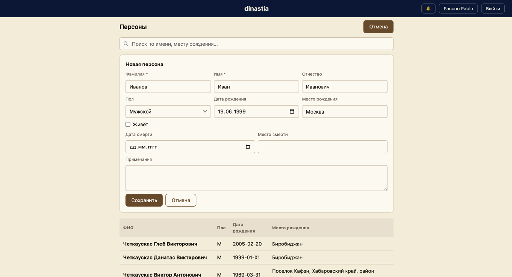
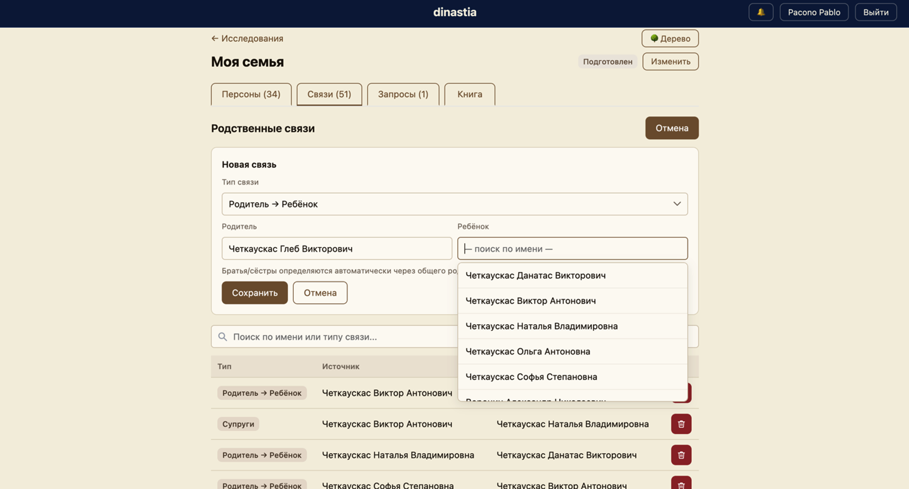
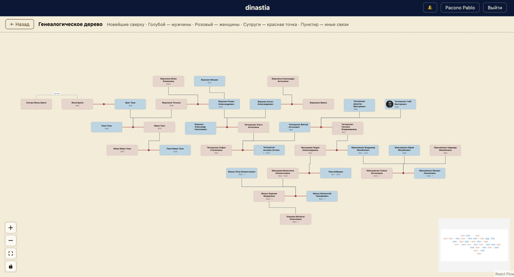
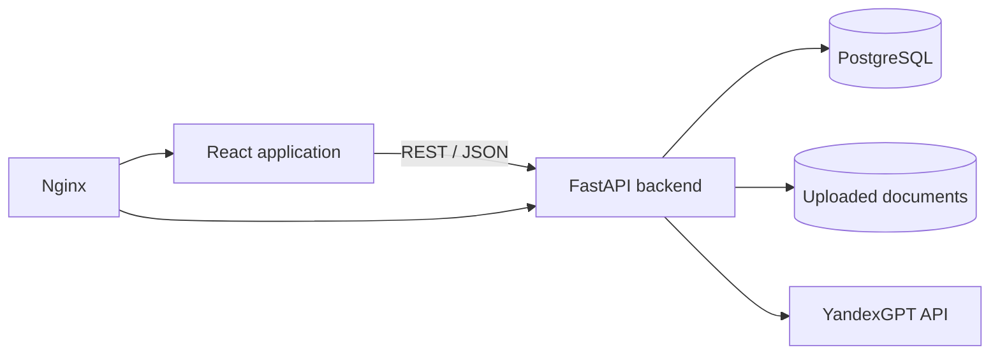

# Dinastia

Dinastia is a full-stack genealogy research platform for building family
histories, visualizing complex family relationships, managing archive research,
and generating readable family books.

The project goes beyond a basic family-tree editor: it supports a complete
research workflow shared by regular users, professional genealogists, and
administrators.

## Key Features

- Genealogy profiles with people, biographical facts, documents, and relationships
- Interactive family-tree visualization with smooth navigation and person details
- Parent-child, spouse, former spouse, sibling, step-relative, and custom relationships
- Archive research requests with statuses, notifications, and specialist assignment
- Genealogist workspace for findings, sources, recommendations, and structured results
- Configurable archive-request templates with autofilled profile data
- Export of prepared archive requests and generated family books
- AI-assisted family narratives through YandexGPT, with a deterministic fallback
- JWT authentication and role-based access for users, genealogists, and administrators

## Screenshots

### Adding a Person

Create a detailed person record with biographical dates, locations, gender,
life status, and research notes.



### Creating a Relationship

Connect existing people with searchable selectors and relationship-specific
validation.



### Interactive Family Tree

Explore a deterministic multi-generation layout with spouse groups,
parent-child trunks, custom relationships, photos, zoom controls, and a
minimap.



## Engineering Highlight: Family-Tree Layout

The main engineering challenge is rendering a readable genealogy graph.
General-purpose graph layouts do not understand family-specific constraints:
spouses should stay together, parents must be above children, multiple marriages
must remain understandable, and edges should not pass through person cards.

Dinastia uses a deterministic layout pipeline that:

1. normalizes people and relationships into family units;
2. groups spouses into horizontal family blocks;
3. calculates generations from parent-child constraints;
4. uses Dagre only for an initial order within generations;
5. improves ordering with barycentric passes and local swaps;
6. packs blocks with guaranteed minimum spacing;
7. routes family edges through shared trunks and collision-aware tracks;
8. detects invalid cycles without preventing the rest of the tree from rendering.

Identical input data produces identical coordinates. The layout prevents card
overlaps and routes lines around cards while minimizing edge crossings and the
overall width of the tree.

## Roles and Workflow

| Role | Responsibilities |
|---|---|
| User | Maintains genealogy profiles, explores the tree, creates archive requests, and receives findings |
| Genealogist | Processes assigned requests, asks for clarification, prepares archive appeals, and records sourced results |
| Administrator | Manages users, genealogists, assignments, request templates, and the overall workflow |

Typical archive research flow:

```text
User creates request
        |
        v
Administrator assigns genealogist
        |
        v
Genealogist researches and prepares archive appeal
        |
        v
User receives findings, sources, and recommendations
```

## Architecture



The backend is a modular monolith. Business modules own their API routes,
schemas, services, and repositories while sharing a single PostgreSQL database.

## Tech Stack

**Backend**

- Python 3.12
- FastAPI and Pydantic v2
- SQLAlchemy 2.0 with async PostgreSQL access
- Alembic migrations
- PyJWT and bcrypt
- pytest

**Frontend**

- React 18 and Vite
- React Router
- React Flow
- Dagre
- Vitest

**Infrastructure**

- PostgreSQL 15
- Docker Compose
- Nginx
- YandexGPT integration

## Repository Structure

```text
.
├── backend/
│   ├── app/
│   │   ├── modules/       # API and business modules
│   │   ├── repositories/  # database access
│   │   ├── models/        # SQLAlchemy models
│   │   └── scripts/       # demo data and admin creation
│   ├── alembic/           # database migrations
│   └── tests/
├── frontend/
│   └── src/
│       ├── pages/
│       ├── components/
│       └── treeLayout.js  # deterministic genealogy layout engine
├── docs/
└── docker-compose.yml
```

## Run Locally

Requirements:

- Docker
- Docker Compose

Create the local configuration and start all services:

```bash
cp .env.example .env
docker compose up --build
```

Open:

- Web application: <http://localhost:8080>
- OpenAPI documentation: <http://localhost:8000/docs>

Stop the application:

```bash
docker compose down
```

Use `docker compose down -v` only when you also want to delete the local
database and uploaded files.

## Demo Data

Create a synthetic user with a ready-to-view three-generation family tree:

```bash
docker compose exec backend python -m app.scripts.seed_demo
```

Demo credentials:

```text
Email: demo@example.com
Password: demo12345
```

The demo account is intended only for local development.

Create an administrator:

```bash
docker compose exec backend python -m app.scripts.create_admin admin@example.com "choose-a-secure-password"
```

## Configuration

All runtime settings are read from `.env`. Start with `.env.example`.

| Variable | Purpose |
|---|---|
| `POSTGRES_*` | PostgreSQL connection settings |
| `SECRET_KEY` | JWT signing key; replace the development value |
| `UPLOAD_DIR` | Backend document storage directory |
| `YANDEX_API_KEY` | Optional Yandex AI Studio API key |
| `YANDEX_FOLDER_ID` | Optional Yandex Cloud folder ID |
| `YANDEX_MODEL` | YandexGPT model name |
| `YANDEX_MODEL_VERSION` | YandexGPT model version |

Without YandexGPT credentials, family books are still generated using the
deterministic narrative fallback.

Never commit `.env`, database dumps, uploaded documents, or production data.

## Development

Run the database in Docker:

```bash
docker compose up -d db
```

Run the backend with hot reload:

```bash
cd backend
python -m venv .venv
source .venv/bin/activate
pip install -e ".[dev]"
alembic upgrade head
uvicorn app.main:app --reload --port 8001
```

Run the frontend:

```bash
cd frontend
npm install
npm run dev
```

## Tests

```bash
cd backend
pytest
```

```bash
cd frontend
npm test
npm run build
```

## Documentation

- [Database model](docs/er-model-3nf.md)
- [Physical database structure](docs/database-physical-structure.md)
- [User interaction scenarios](docs/user-dialog-scenarios.md)

## License

Released under the [MIT License](LICENSE).
